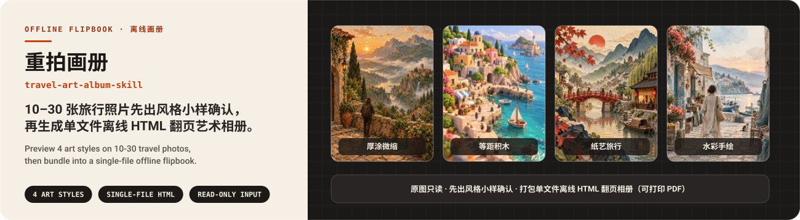
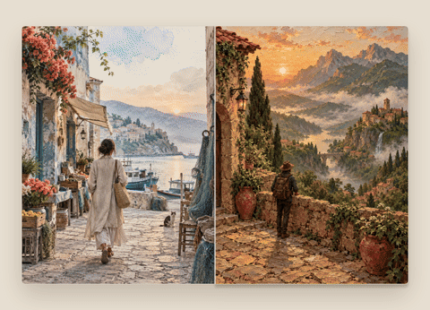

# 重拍画册｜旅行照片艺术画册与离线翻页相册 Skill

<!-- discovery:start -->
## 旅行照片艺术画册与离线 HTML 翻页相册

**怎样把旅行照片做成能离线翻页、打印 PDF 的艺术画册？** 先清点 10–30 张照片、确认艺术风格小样，再制作单文件 HTML 翻页相册；成品支持离线阅读和浏览器打印。

Travel photo art album and offline HTML flipbook.

**开始使用：** [安装与制作流程](#quick-start) · [输入与小样示例](#quick-example)。

**使用边界：** 原图只读，确认小样后才批量处理；成品离线不代表艺术化生成离线，图像模型可能产生费用。

[按任务浏览欧八同学的全部工具](https://github.com/ouxxyy/ouba-classmate#按需求找)；如果本项目有帮助，欢迎收藏当前仓库。

<!-- discovery:end -->

<!-- hero:start -->

<p>
  <a href="https://github.com/ouxxyy/ouba-classmate"></a>
</p>

**先为旅行照片生成厚涂微缩、治愈积木、纸艺旅行或水彩编辑风格小样，确认方向后一键封装成可离线翻页、带 3D 动效与 PDF 导出的单文件 HTML 画册。**  
<sub>Transforms 10-30 travel photos into cohesive miniature/papercraft/watercolor art proofs and compiles a standalone offline 3D flipbook HTML.</sub>

<p>
  <a href="https://github.com/ouxxyy/ouba-classmate"></a>
  <a href="#quick-example"></a>
  <a href="#quick-start"></a>
  <a href="#english-overview"></a>
  <a href="https://github.com/ouxxyy"></a>
</p>


<!-- hero:end -->

旅行照片拍完，很多时候就留在相册里，很少再认真看一遍。这个 Skill 想做的事情很具体：把一组照片先做成风格小样，等你选定方向，再把它们整理成一份可以离线打开、翻页和导出 PDF 的旅行画册。

它适合 10–30 张照片。四种风格可以整本统一，也可以一张一张混着用：厚涂微缩、等距治愈积木、纸艺旅行，以及编辑旅行摄影 × 水彩手绘。

> [!TIP]
> 🎁 扫码关注公众号「欧八同学」，免费领取 AI 案例与 Skill《大厂产品AI经验编程 200 套》→ [去扫码](#author)

[使用示例](#quick-example) · [开始使用](#quick-start) · [English](#english-overview)

<a id="quick-example"></a>

## 一次使用示例

**输入示例：** 一个目录第一层的 18 张旅行照片，想尝试纸艺旅行风格，并保留人物辨识度。

**输出：** 先清点照片并制作少量风格小样，等你确认后再批量处理，最后打包为单文件 HTML 翻页画册；成品可离线翻阅，也可用浏览器打印 PDF。原图只读，确认前不进入批量阶段。

下方画廊和 GIF 使用公开虚构素材。可按 [安装说明](#quick-start) 使用 Skill，构建清单结构见 [混合风格示例](examples/mixed-style-manifest.json)。

## 先看看成品是什么感觉

下面的示例图是专门为这个公开仓库生成的虚构素材，不含本地真人照片，也不对应任何真实旅行者。四张图正好对应 Skill 内置的四种风格。

<table>
  <tr>
    <td align="center"><br><sub>厚涂微缩</sub></td>
    <td align="center"><br><sub>等距治愈积木</sub></td>
    <td align="center"><br><sub>纸艺旅行</sub></td>
    <td align="center"><br><sub>编辑旅行摄影 × 水彩手绘</sub></td>
  </tr>
</table>

这是用同一组示例图做的翻页演示：



## 它会怎么工作

1. 先清点照片，只处理输入目录第一层，不动原图。
2. 从照片里挑出人物近景、合照和环境照，做最多 12 张风格小样。
3. 把小样给你看，等你明确确认风格；确认前不会批量生成。
4. 按确认结果生成内页，再单独生成一张封面。
5. 把图片和排版打包成一个离线 HTML 画册，浏览器打开就能翻页，也可以打印成 PDF。

人物辨识度和旅行事实优先。不会凭空增加人物、交换身份，也不会把你的私人照片放进这个公开仓库。

<a id="quick-start"></a>

## 怎么安装

### 只安装 Skill

如果你只是想让 Codex 或 Claude Code 使用它，不需要先安装 Node 依赖。以 Codex 为例：

```bash
git clone https://github.com/ouxxyy/travel-art-album-skill.git
cd travel-art-album-skill

mkdir -p ~/.codex/skills/travel-art-album/{docs,scripts}
cp SKILL.md ~/.codex/skills/travel-art-album/
cp -R references ~/.codex/skills/travel-art-album/
cp docs/capability-check.md docs/source-license.md ~/.codex/skills/travel-art-album/docs/
cp scripts/validate-manifest.mjs ~/.codex/skills/travel-art-album/scripts/
```

使用 Claude Code 时，把上面的 `~/.codex/skills/` 换成 `~/.claude/skills/`。

### 运行项目里的构建器和测试

只有在你要运行原型、校验清单或构建 HTML 画册时，才需要安装依赖：

```bash
npm install
npm run build:prototype
npm test
```

## 第一次使用时，可以这样说

把照片目录换成你自己的路径，直接发给智能体：

```text
用 travel-art-album 把 /path/to/my-travel-photos 做成离线翻页画册。
先清点第一层照片，选 3 张代表照做四种风格小样，给我看完后停下来等确认。
确认前不要批量生成；确认后再做内页、单独封面和最终 HTML，并告诉我文件在哪里。
```

如果你已经准备好照片，也可以只说：“帮我把这组旅行照片做成重拍画册”，再补充书名和想统一的风格。

## 手动校验和构建

```bash
# 校验示例清单
npm run validate:example

# 校验自己的清单
node scripts/validate-manifest.mjs "/path/to/制作清单.json"

# 确认可以进入批量阶段
node scripts/validate-manifest.mjs "/path/to/制作清单.json" --batch-ready

# 构建单文件离线画册
node scripts/build-album.mjs "/path/to/制作清单.json"
```

原型输出在 `dist/prototype.html`。成品构建器默认输出 `旅行的意义.html`；具体输出位置以清单里的设置为准。生成的 HTML 可以直接用 `file://` 打开，不依赖外部网络。

## 使用前需要知道的几件事

- 宿主需要能读文件、执行脚本、查看图片，并支持把本地原图作为参考图交给图像编辑能力。
- 原图只读，不递归扫描；支持 JPG、JPEG、PNG、WebP 和 HEIC。
- 公开仓库里的示例图是虚构素材。真实照片、制作清单和私人画册请放在自己的验收目录，不要提交到 GitHub。
- 原型里的占位插画只是交互演示，不等于真实生图效果。
- 当前自动化检查覆盖本机 Chrome；Safari 和移动真机需要你自己再看一遍。

## 常见问题

### 只是安装 Skill，也要 npm install 吗？

不需要。只有运行构建器、原型或测试时才安装 Node 依赖，具体见 [安装说明](#quick-start)。

### 可以直接把整批照片都变成插画吗？

先做小样并等你明确确认风格，再进入批量阶段；人物辨识度和旅行事实优先。

### 离线相册代表生图也离线吗？

不代表。离线的是最终 HTML；图像编辑依赖宿主提供的参考图能力，数据处理和费用取决于所选服务。

### 所有格式和浏览器都经过验收了吗？

当前自动化检查覆盖本机 Chrome。真实 HEIC、Safari、移动真机及人物辨识度仍需按实际素材复核，详见 [能力检查](docs/capability-check.md)。

<a id="english-overview"></a>

## English overview

A travel photo album Agent Skill that turns 10–30 photos into approved style samples and a single-file offline HTML flipbook, with browser PDF printing. Source photos stay read-only; only the input folder's first level is processed.

Follow [installation](#quick-start). Installing the Skill does not require npm dependencies. Your host must support reference-image editing, and batch generation starts only after style approval. Offline describes the finished album, not the image-generation service. Review [capability limits](docs/capability-check.md) and [source licenses](docs/source-license.md).

<!-- suite-matrix:start -->

## 更多开源项目 · More from ouba-classmate Suite

> 如果这个项目帮到了你，欢迎去旗舰合集仓 [**`ouxxyy/ouba-classmate`**](https://github.com/ouxxyy/ouba-classmate) 点一颗 Star 或一行安装全部 Skills：
> `npx skills add ouxxyy/ouba-classmate` · `gh api -X PUT /user/starred/ouxxyy/ouba-classmate`

| 仓库 · Repo | 分类 · Category | 它做什么 · What it does |
| --- | --- | --- |
| [`ouba-classmate`](https://github.com/ouxxyy/ouba-classmate) | SUITE · 旗舰合集 | **11 个原创项目总仓 + 一键安装全部 Skills + 在线战力测算与防身情报库**<br><sub>All-in-one Skills suite & benchmark</sub> |
| [`jd-resume-match`](https://github.com/ouxxyy/jd-resume-match) | CAREER · 求职涨薪 | **AI 简历优化与 JD 匹配体检（确定性公式 + 行号证据）**<br><sub>Deterministic JD matching & line-cited resume audit</sub> |
| [`ai-interviewer`](https://github.com/ouxxyy/ai-interviewer) | CAREER · 求职涨薪 | **中文语音/文字原话追问 AI 模拟面试官（含在线版）**<br><sub>Chinese voice AI mock interviewer anchored to your answers</sub> |
| [`job-search`](https://github.com/ouxxyy/job-search) | CAREER · 求职涨薪 | **跨 5 平台实时去重筛岗，输出带来源短名单**<br><sub>5-platform source-backed job search & shortlist builder</sub> |
| [`sherlock-company`](https://github.com/ouxxyy/sherlock-company) | CAREER · 求职涨薪 | **入职前四态证据公司背调与 Offer 核实清单**<br><sub>Pre-offer employer research with 4-state evidence boundaries</sub> |
| [`mbai`](https://github.com/ouxxyy/mbai) | CAREER · 求职涨薪 | **工作任务 AI 不可替代指数与 4 核决策复盘**<br><sub>Task-level AI irreplaceability index & decision reflection</sub> |
| [`codex-gif-video`](https://github.com/ouxxyy/codex-gif-video) | CREATIVE · AI 创作 | **69 种风格原生 GIF 与静音 MP4 素材生成 Skill**<br><sub>Native GPT Image 2.6 animated GIF & MP4 generator (69 styles)</sub> |
| [`storyboard-scavenger`](https://github.com/ouxxyy/storyboard-scavenger) | CREATIVE · AI 创作 | **可灵/即梦/Veo/Sora 七要素 AI 视频分镜工作流**<br><sub>7-element AI video storyboard skill for Kling & Seedance</sub> |
| [`travel-art-album-skill`](https://github.com/ouxxyy/travel-art-album-skill) · **Current** | CREATIVE · AI 创作 | **旅行照片艺术画册与单文件离线翻页相册 Skill**<br><sub>Art-styled travel photo proofs & standalone offline HTML flipbook</sub> |
| [`mystery-skill`](https://github.com/ouxxyy/mystery-skill) | COGNITION · 认知框架 | **Mystery 认知框架与职场心理博弈分析 Skill**<br><sub>Cognitive framework for interview frame & decision study</sub> |
| [`Attention`](https://github.com/ouxxyy/Attention) | LOCAL APP · 本地工具 | **ActivityWatch 本地专注力、心流时段与切换分析**<br><sub>Local ActivityWatch focus & context-switching dashboard</sub> |
| [`postapp`](https://github.com/ouxxyy/postapp) | LOCAL APP · 本地工具 | **Chrome 本地摄像头姿态检测与坐姿提醒插件**<br><sub>On-device MoveNet Chrome posture reminder extension</sub> |

<!-- suite-matrix:end -->

<a id="author"></a>

## 作者

作者全平台同名：**欧八同学**。

- 个人主页 / 联系我：[albertou.redboook.cn](https://albertou.redboook.cn/)
- 微信公众号：扫码关注，免费领取 AI 案例与 Skill《大厂产品AI经验编程 200 套》
- 抖音：[搜索“欧八同学”](https://www.douyin.com/search/%E6%AC%A7%E5%85%AB%E5%90%8C%E5%AD%A6)
- 小红书：[搜索“欧八同学”](https://www.xiaohongshu.com/search_result?keyword=%E6%AC%A7%E5%85%AB%E5%90%8C%E5%AD%A6)
- X：[搜索“欧八同学”](https://x.com/search?q=%E6%AC%A7%E5%85%AB%E5%90%8C%E5%AD%A6&src=typed_query)

<p align="center">
  
</p>

<p align="center"><sub>扫码关注「欧八同学」，免费领取《大厂产品AI经验编程 200 套》</sub></p>

如果这个项目对你有用，欢迎点个 Star。遇到问题时，提交命令、报错和最小复现步骤就够了；请不要上传真实私人照片。

## 许可

第三方来源和许可记录见 [`docs/source-license.md`](docs/source-license.md) 与 [`THIRD_PARTY_NOTICES.md`](THIRD_PARTY_NOTICES.md)。随项目附带的许可全文位于 `vendor/licenses/` 和 `references/styles/LICENSE`。

<!-- footer:start -->

<p align="center">
  <a href="https://github.com/ouxxyy"></a>
</p>

<!-- footer:end -->
